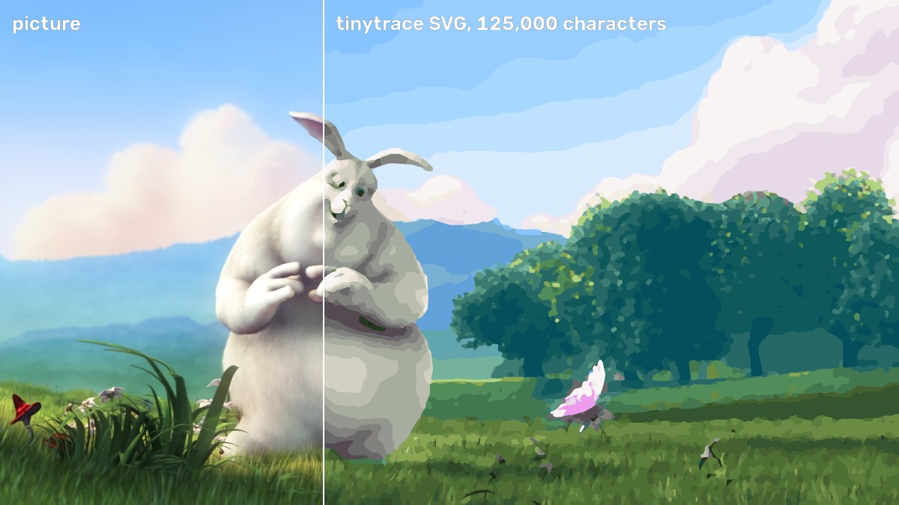
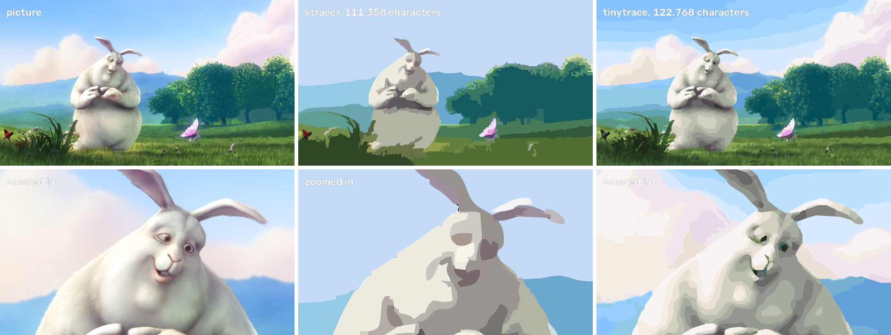
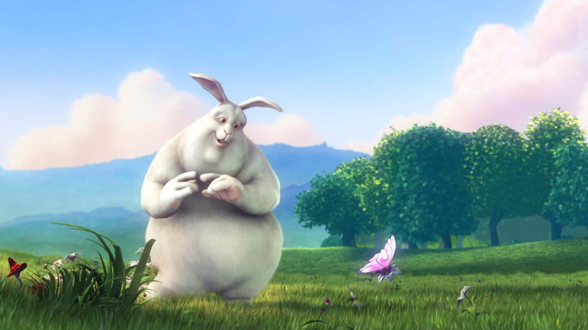
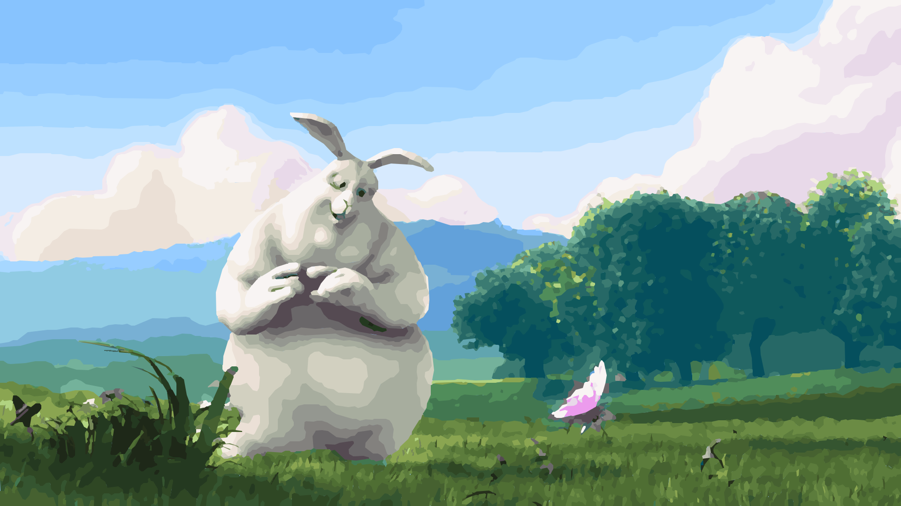
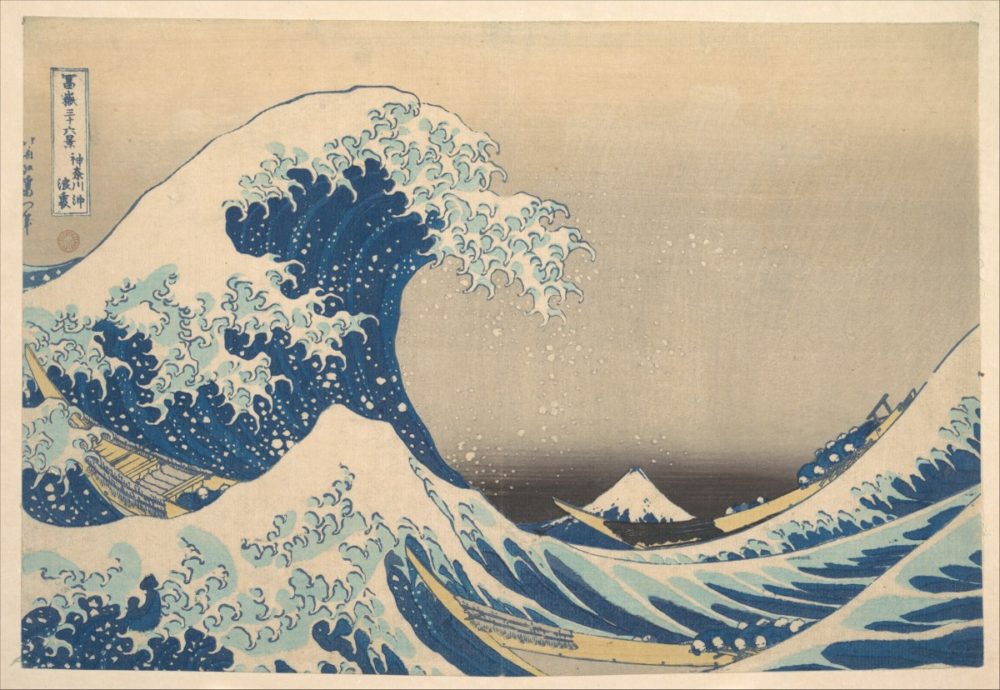
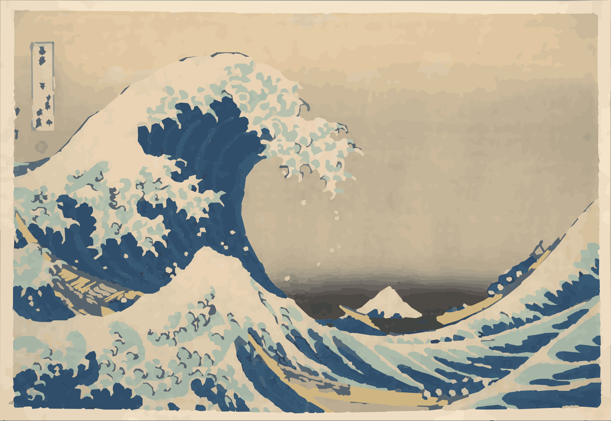
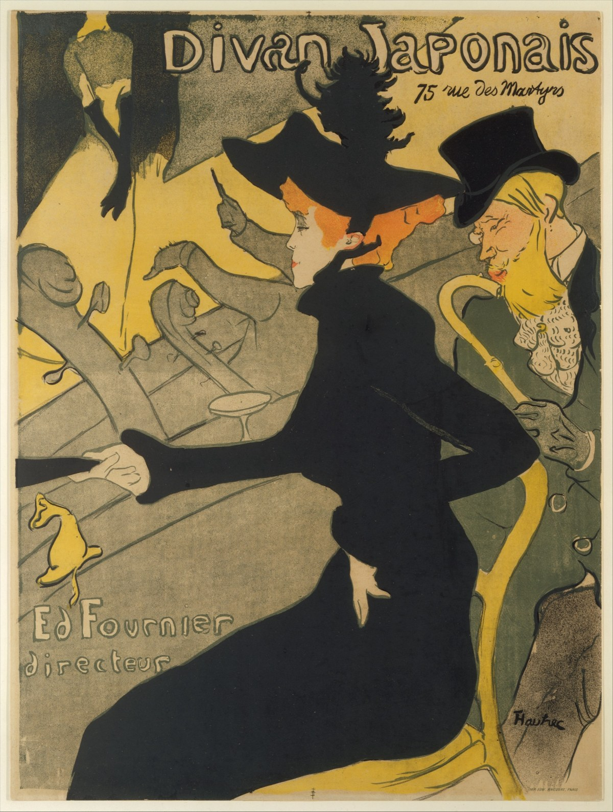
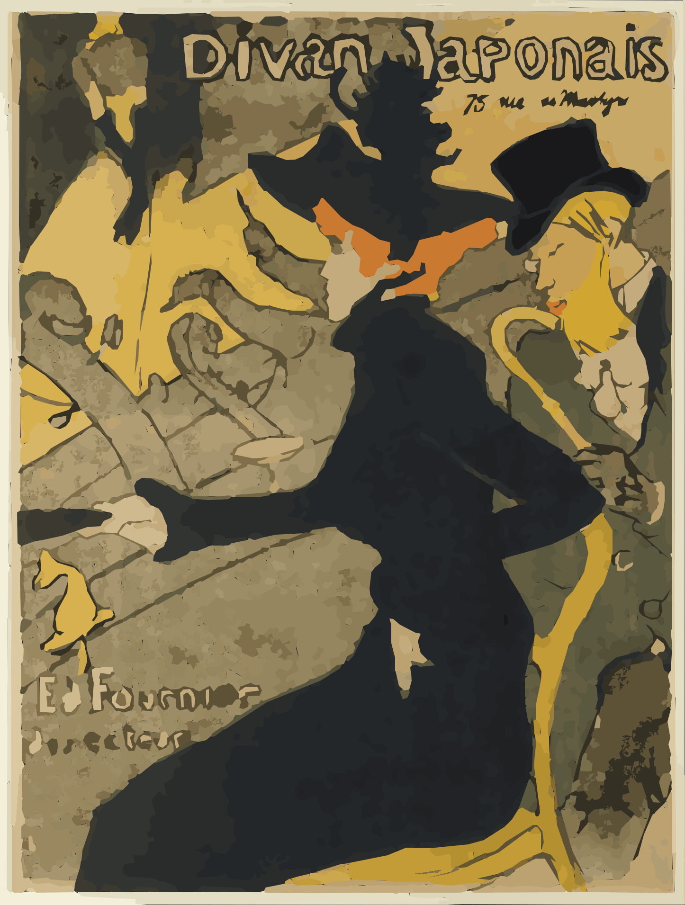
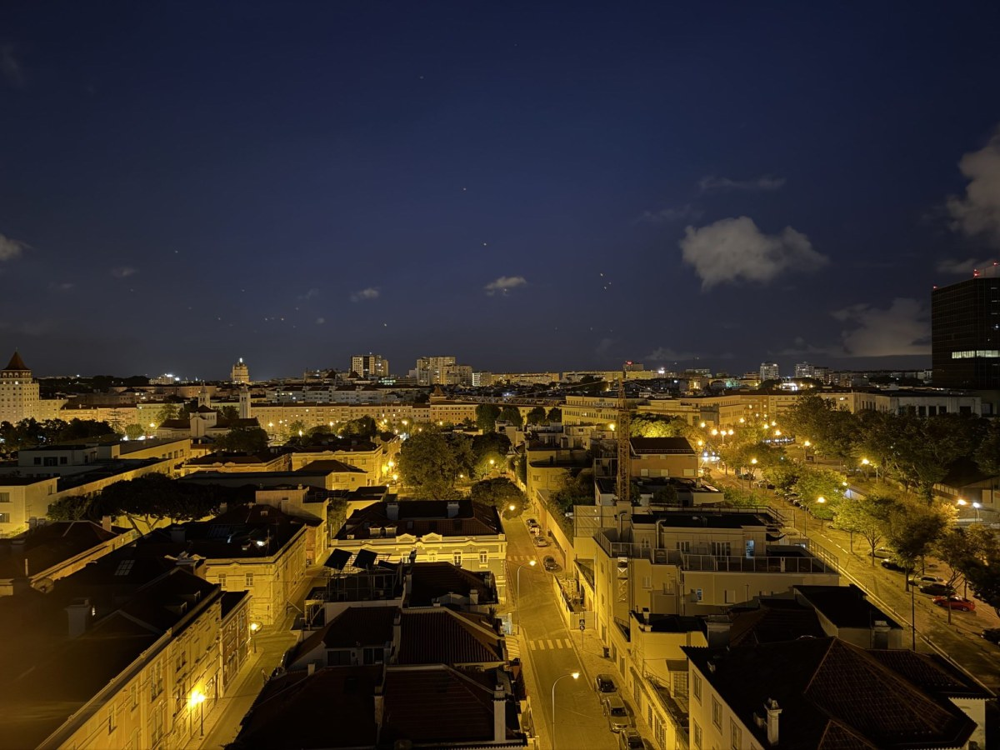
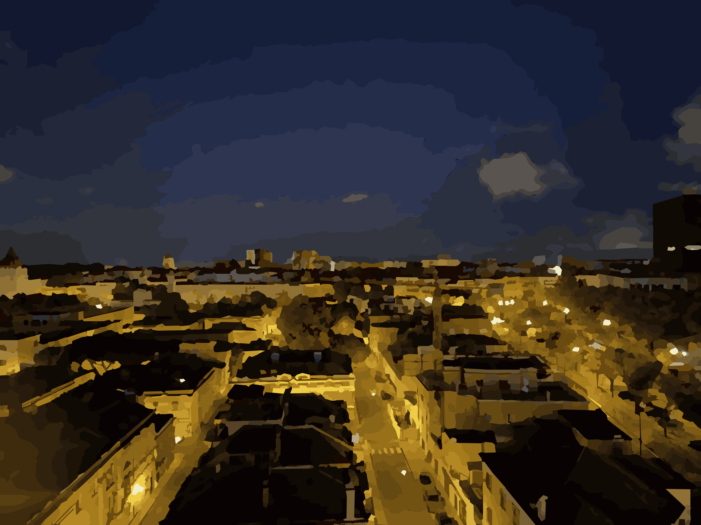

<h1 align="center">tinytrace</h1>

<p align="center">
  Turn a picture into the best-looking SVG that fits a size budget.<br>
  You pick how many characters the SVG may have. tinytrace makes the most of them.
</p>

<p align="center">
  <a href="https://pypi.org/project/tinytrace/"></a>
  <a href="https://github.com/itsmesherry/tinytrace/actions/workflows/ci.yml"></a>
  <a href="https://pypi.org/project/tinytrace/"></a>
  <a href="https://github.com/itsmesherry/tinytrace/blob/main/LICENSE"></a>
</p>

<p align="center">
  
</p>

Most tracers try to match the picture and let the SVG grow as large as it needs
to. tinytrace works the other way round: you fix the size first, say "under
125,000 characters", and it finds the most faithful picture that fits. That's
what you want when an SVG has a hard limit: an inline image on a web page, an
email, a config file, or a desktop backdrop with a size cap.

```bash
pip install tinytrace
tinytrace picture.jpg --budget 125000
# picture.svg: 124,612 characters (budget 125,000), 9s
```

```python
import tinytrace

svg = tinytrace.trace("picture.jpg", budget=125_000)
```

## How it compares

The same frame traced by [vtracer](https://github.com/visioncortex/vtracer) and
by tinytrace, both held to 125,000 characters:

<p align="center">
  
</p>

vtracer has no size setting, so it gets a fair search over its own: input size,
speck size, how much it merges similar colours, and stacked or cutout layers.
Of the 144 combinations, the one that scores best against the picture counts.
On 23 pictures tinytrace was not tuned on:

| Pictures | Colour error ↓ | Shape match ↑ | Outlines kept ↑ |
| --- | :---: | :---: | :---: |
| Cartoons (6) | **1.51** vs 2.08 | **0.98** vs 0.97 | **0.95** vs 0.89 |
| Digital art (4) | **2.79** vs 7.47 | **0.91** vs 0.82 | **0.71** vs 0.48 |
| Photos (13) | **3.86** vs 8.92 | **0.89** vs 0.75 | **0.71** vs 0.47 |

Per picture, tinytrace scored better on all three on 17 of the 23, and had the
lower colour error on 19. vtracer was a little more accurate in colour on four
very flat cartoons, where it needs far fewer characters. Colour error is the
mean CIE Lab difference after a light blur (about 2 is barely visible), shape
match is SSIM, and outlines kept is the share of the picture's strong edges the
SVG also has. See [bench/](https://github.com/itsmesherry/tinytrace/tree/main/bench)
to run it on your own pictures.

Photos come out painterly. Any tracer turns a photo into flat shapes, and at
this size tinytrace keeps them recognisable rather than photographic.

## Examples

<!-- docs/images/*.jpg and *.svg: each picture beside its SVG, made with docs/make_examples.py -->

| Picture | tinytrace, 125,000 characters |
| --- | --- |
|  |  |
|  |  |
|  |  |
|  |  |

## Options

| Option | Default | Meaning |
| --- | --- | --- |
| `budget` / `--budget` | 125000 | The most characters the SVG may have |
| `colors` / `--colors` | 40 | Fill palette size. More gives truer shading but leaves fewer characters for detail |
| `cover` / `--cover` | off | Fill any box the SVG is drawn in, cropping the edges (for backgrounds) |

`trace()` takes a file path or an OpenCV-style BGR `uint8` array, and raises
`tinytrace.BudgetTooSmall` when even the coarsest tracing is over the budget.
A trace takes about 10 seconds, whatever the picture's size.

## How it works

1. **Work at 1920 pixels wide.** Small pictures are enlarged smoothly first, so
   edges follow curves instead of the source's pixel steps.
2. **Fills.** Mean-shift flattens texture noise, k-means picks the palette in
   Lab colour space, and a majority vote straightens ragged borders.
3. **Ink.** Lines darker than their surroundings, like cartoon outlines, are
   found on the unfiltered picture and painted last, on top, in a few ink
   colours of their own.
4. **Stacked layers.** Fills are painted largest first, and each may extend
   under anything painted after it. Its outline then skips the holes and jaggies
   later layers hide, so each border is stored about once instead of twice.
5. **Polygons, searched to fit.** Outlines are simplified polygons written as
   short relative steps. The tolerance and the smallest speck kept are searched
   so the SVG fills the budget as closely as it can.

None of these steps is new on its own. tinytrace combines them and tunes them
for one goal: the most faithful picture in a fixed number of characters.

## Example: a picture backdrop for the Claude desktop app

[examples/claude-backdrop](https://github.com/itsmesherry/tinytrace/tree/main/examples/claude-backdrop) is a Claude desktop mod
that shows a slideshow of your own pictures behind the chat. The app caps a
backdrop scene at 131,072 characters, which is where tinytrace came from.

## Credits

Example pictures, each under its own licence (the MIT licence covers the code only):

- *Big Buck Bunny* frame © Blender Foundation,
  [peach.blender.org](https://peach.blender.org), licensed
  [CC BY 3.0](https://creativecommons.org/licenses/by/3.0/).
- *Under the Wave off Kanagawa*, Katsushika Hokusai, and *Divan Japonais*,
  Henri de Toulouse-Lautrec: public domain, from
  [The Metropolitan Museum of Art](https://www.metmuseum.org/about-the-met/policies-and-documents/open-access).
- City at night: photo by Jeff Golenski,
  [WordPress Photo Directory](https://wordpress.org/photos/photo/3016a7fb59/), CC0.

## License

[MIT](https://github.com/itsmesherry/tinytrace/blob/main/LICENSE)
